## Learning objectives: from W4 to W6
:::::: {.slide-body .compact-table}
| Task | W4: dictionaries | W6: classification |
|---|---|---|
| Build a measure | Select words and rules | Learn from labelled comments |
| Use human evidence | Validate dictionary output | Train and evaluate classifiers |
| Develop the method | Inspect KWIC; revise rules | Fit ML algorithms and predict new texts |
| Assess results | Read errors and sensitivity | Reserved test and human benchmark |

**Today, we'll use machine learning with two real datasets:**

1. Political hate speech in Taiwan.
2. Grandstanding statements in US congressional hearings.
::::::
::: {.source}
Course progression: [W4: Dictionaries and Sentiment Analysis](https://raw.githack.com/davidycliao/NTLDEV-7191-1151/main/W4/slide/week4.html) to W6.
:::

## Cases we use in W6
:::::: {.slide-body .compact-table}
| Research case | Source | Teaching connection |
|---|---|---|
| **Wang, Day & Wu (2022)** | [IEEE Access](https://doi.org/10.1109/ACCESS.2022.3160712) | Hate speech: Chinese character counts |
| Gillion (2016) | [*Governing with Words*](https://www.cambridge.org/core/books/governing-with-words/5D4F713A016401E3FC3922C66D371FF2) | Coding rules and agreement |
| Benoit et al. (2016) | [APSR](https://doi.org/10.1017/S0003055416000058) | Crowd coding and reproducibility |
| Boydstun (2013) | [*Making the News*](https://www.amber-boydstun.com/supplementary-information-for-making-the-news.html) | Codebooks and rare categories |
| Nielsen (2017) | [*Deadly Clerics*](https://www.mit.edu/~rnielsen/deadlyclerics.htm) | Found labels and validation |
| Park (2021) | [JOP](https://doi.org/10.1086/709147) | Grandstanding: mlr3 linear SVM |
::::::
::: {.source}
Original-study sources accompany each literature case. Classification practice uses the data from Wang, Day & Wu (2022) and Park (2021).
:::

## Wang, Day & Wu: political hate speech in Taiwan
:::::: {.slide-body}
::::: {.columns .paper-intro-columns}
:::: {.column}
::: {.screenshot-viewport}
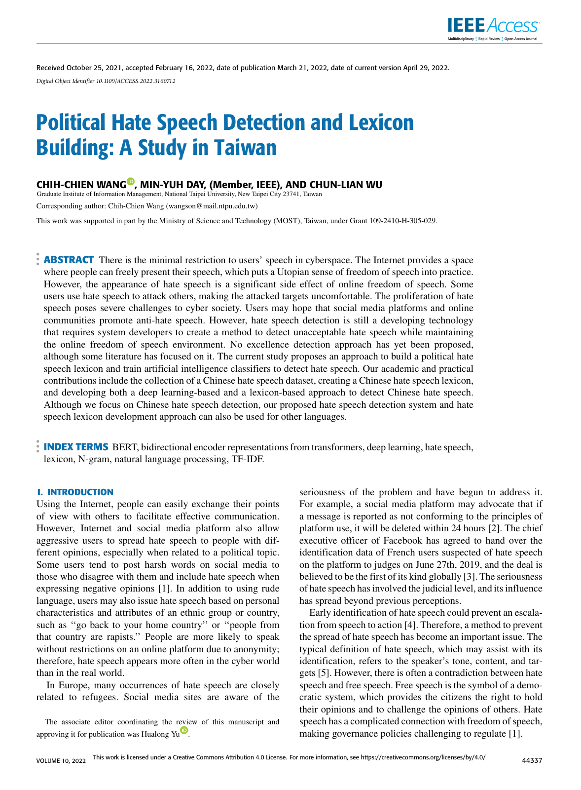{fig-alt="Published first page of Political Hate Speech Detection and Lexicon Building: A Study in Taiwan, Wang, Day and Wu, 2022."}
:::

::: {.caption}
2022
:::
::::
:::: {.column}
- **Texts:** Chinese political news comments.
- **Study:** a hate-speech lexicon and BERT classifiers.
- **Our exercise:** we'll fit NB to the Wang, Day & Wu (2022) data.
::::
:::::
::::::
::: {.source}
[Wang, Day & Wu (2022)](https://doi.org/10.1109/ACCESS.2022.3160712).
:::

## Gillion: measuring political discussion of race
:::::: {.slide-body}
::::: {.columns .case-columns .gillion-columns}
:::: {.column .gillion-cover}
{.book-cover fig-alt="Governing with Words book cover, by Daniel Q. Gillion."}

::: {.caption}
Cambridge University Press, 2016
:::
::::
:::: {.column}
- **Question:** how do politicians discuss racial and ethnic minority concerns?
- **Texts:** presidential public remarks and congressional oral remarks.
- **Application:** humans label paragraphs; classifiers extend the coding to the full corpus.
- **Research use:** compare political attention across politicians and time.
::::
:::::
::::::
::: {.source}
§17.1. Gillion (2016), [Governing with Words](https://www.cambridge.org/core/books/governing-with-words/5D4F713A016401E3FC3922C66D371FF2), [Appendix A](https://doi.org/10.1017/CBO9781316412299.011), [Appendix B](https://doi.org/10.1017/CBO9781316412299.012).
:::

## Gillion: coding boundaries and agreement
:::::: {.slide-body}
::::: {.gillion-tabset #gillion-tabs data-arrow-tabs="true"}
```{=html}
<div class="gillion-tablist" role="tablist" aria-label="Gillion coding choices">
<button type="button" role="tab" id="gillion-tab-1" aria-controls="gillion-panel-1" aria-selected="true" tabindex="0">Unit</button>
<button type="button" role="tab" id="gillion-tab-2" aria-controls="gillion-panel-2" aria-selected="false" tabindex="-1">Training labels</button>
<button type="button" role="tab" id="gillion-tab-3" aria-controls="gillion-panel-3" aria-selected="false" tabindex="-1">Coding rule</button>
<button type="button" role="tab" id="gillion-tab-4" aria-controls="gillion-panel-4" aria-selected="false" tabindex="-1">Agreement</button>
</div>
```
::::: {.gillion-sequence}
:::: {.gillion-step #gillion-panel-1 role="region" aria-labelledby="gillion-tab-1"}
**Unit:** paragraphs; exclude written bills and procedural material.
::::

:::: {.gillion-step .fragment #gillion-panel-2 role="region" aria-labelledby="gillion-tab-2" data-fragment-index="0"}
**Training labels:** two assistants code random samples: 300 paragraphs per presidential administration and 1,000 per congressional session.
::::

:::: {.gillion-step .fragment #gillion-panel-3 role="region" aria-labelledby="gillion-tab-3" data-fragment-index="1"}
**The rule requires an explicit racial reference:** a group, race-specific policy, minority figure, or race-specific issue.

General crime, education, or health discussion qualifies only with such a reference.
::::

:::: {.gillion-step .fragment #gillion-panel-4 role="region" aria-labelledby="gillion-tab-4" data-fragment-index="2"}
**Reported intercoder reliability: 97%.** Gillion adjudicates disagreements.

**Discussion:** What would this measure miss about implicit racial appeals?
::::

:::::
:::::
```{=html}
<script>
(() => {
  const mount = () => {
    if (!window.Reveal) return;
    document.querySelectorAll('[data-arrow-tabs]').forEach(root => {
    if (root.dataset.ready) return;
    root.dataset.ready = 'true';
    const slide = root.closest('section');
    const tabs = [...root.querySelectorAll('[role="tab"]')];
    const refresh = () => {
      if (Reveal.getCurrentSlide() !== slide) return;
      const index = Math.max(0, Math.min(tabs.length - 1,
        (Reveal.getIndices().f ?? -1) + 1));
      const focusInTabs = tabs.includes(document.activeElement);
      tabs.forEach((tab, i) => {
        tab.setAttribute('aria-selected', String(i === index));
        tab.tabIndex = i === index ? 0 : -1;
      });
      if (focusInTabs) tabs[index].focus({preventScroll: true});
    };
    tabs.forEach((tab, i) => {
      tab.addEventListener('click', () => {
        Reveal.navigateFragment(i - 1);
        refresh();
      });
      tab.addEventListener('keydown', event => {
        if (!['Home', 'End'].includes(event.key)) return;
        event.preventDefault();
        event.stopPropagation();
        Reveal.navigateFragment(event.key === 'Home' ? -1 : tabs.length - 2);
        refresh();
      });
    });
    ['ready', 'slidechanged', 'fragmentshown', 'fragmenthidden'].forEach(
      event => Reveal.on(event, refresh));
    refresh();
    });
  };
  document.addEventListener('DOMContentLoaded', mount);
  window.addEventListener('load', mount);
  if (document.readyState !== 'loading') mount();
})();
</script>
```
::::::
::: {.source}
Gillion (2016), [Appendix A, pp. 163–166](https://doi.org/10.1017/CBO9781316412299.011). The 97% concerns coders, not classifier accuracy.
:::

## Gillion: interpreting the measure {#gillion-interpretation}
:::::: {.slide-body .gillion-interpretation}
- **Missed content:** coded racial messages without an explicit racial reference.
- **Example:** “inner city” can carry racial meaning in context; the phrase alone is not enough to infer a racial appeal.
- **What we learn:** 97% agreement shows consistent coding. We still need to ask whether the rule captures implicit appeals.
::::::
::: {.source}
Course interpretation of [Gillion (2016), Appendix A](https://doi.org/10.1017/CBO9781316412299.011) · Racial cue example: [White (2007)](https://doi.org/10.1017/S0003055407070177).
:::

## Benoit et al.: crowd coding political text
:::::: {.slide-body}
::::: {.columns .paper-intro-columns .benoit-intro-columns}
:::: {.column}
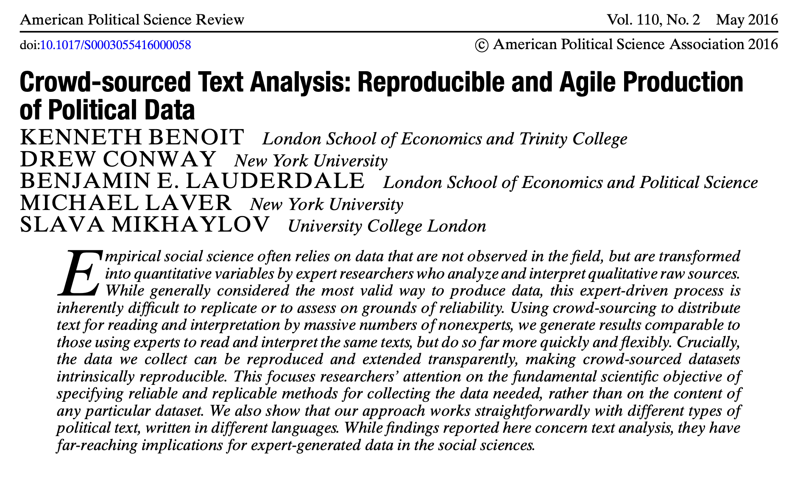{fig-alt="Instructor-provided screenshot of the APSR article first page, with journal header, title, authors, and abstract."}

::: {.caption}
APSR, 2016 · first-page excerpt
:::
::::
:::: {.column}
- **Texts:** manifesto sentences.
- **Coding:** repeated crowd judgments.
- **Validation:** compare with experts.
::::
:::::
::::::
::: {.source}
[Benoit et al. (2016), APSR](https://doi.org/10.1017/S0003055416000058) · [Replication](https://github.com/kbenoit/CSTA-APSR) · Connection: §18.3.
:::

## Crowd coding: a simple coding scheme
:::::: {.slide-body}
::::: {.columns .paper-figure-columns}
:::: {.column}
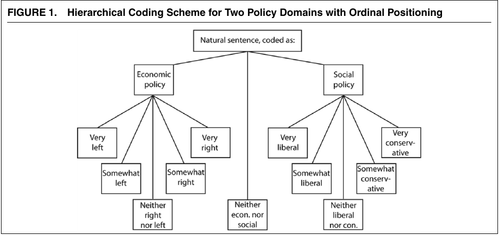{fig-alt="Original APSR Figure 1: policy domains followed by ordinal positions."}

::: {.caption}
Figure 1 · original coding scheme
:::
::::
:::: {.column}
- **First:** classify the topic.
- **Then:** rate the position.
- **Design:** keep tasks simple.
::::
:::::
::::::
::: {.source}
[Benoit et al. (2016), APSR](https://doi.org/10.1017/S0003055416000058) · Figure 1, p. 281.
:::

## Crowd coding: reproducing the judgments
:::::: {.slide-body}
::::: {.columns .paper-figure-columns}
:::: {.column}
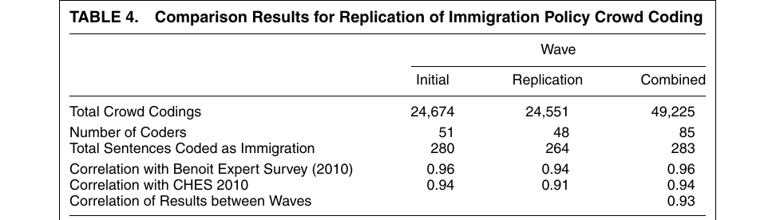{fig-alt="Original APSR Table 4: initial and replication immigration coding waves."}

::: {.caption}
Table 4 · immigration coding replication
:::
::::
:::: {.column}
- **Repeat:** two coding waves.
- **Result:** party scores correlate **.93**.
- **Scope:** aggregate reproducibility.
::::
:::::
::::::
::: {.source}
[Benoit et al. (2016), APSR](https://doi.org/10.1017/S0003055416000058) · Table 4, p. 291.
:::

## Crowd coding: the coal-mine policy case
:::::: {.slide-body}
::::: {.columns .paper-figure-columns}
:::: {.column}
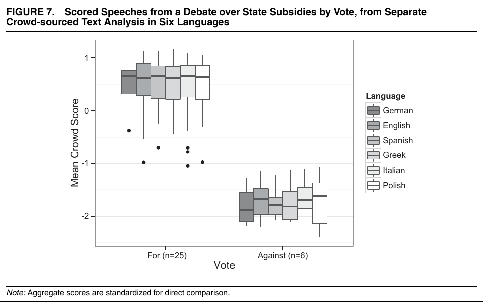{fig-alt="Original APSR Figure 7: subsidy-position scores by vote and language."}

::: {.caption}
Figure 7 · coal-mine aid debate
:::
::::
:::: {.column}
- **Texts:** 36 EP speeches.
- **Plot:** 31 votes; six languages.
- **Check:** scores against votes.
::::
:::::
::::::
::: {.source}
[Benoit et al. (2016), APSR](https://doi.org/10.1017/S0003055416000058) · Figure 7, p. 292.
:::

## Boydstun: measuring the news agenda
:::::: {.slide-body}
::::: {.columns .case-columns .boydstun-columns}
:::: {.column .boydstun-cover}
{.book-cover fig-alt="Making the News: Politics, the Media, and Agenda Setting book cover, by Amber E. Boydstun."}

::: {.caption}
Book cover · University of Chicago Press, 2013
:::
::::
:::: {.column}
- **Question:** how is news attention distributed across policy issues over time?
- **Data:** New York Times front-page stories, 1996–2006.
- **Application:** human coders assign policy topics; counts track media attention across issues and time.
- **Our first step:** apply the topic labels consistently before we compare issues.
::::
:::::
::::::
::: {.source}
§18.2.7. Boydstun (2013), [book supplements](https://www.amber-boydstun.com/supplementary-information-for-making-the-news.html).
:::

## Boydstun: a codebook for newspaper topics
:::::: {.slide-body}
::::: {.columns .paper-intro-columns}
:::: {.column}
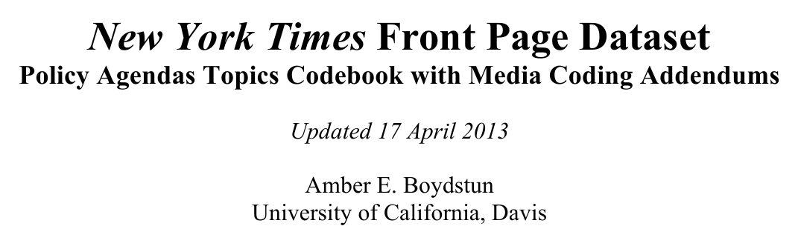{fig-alt="New York Times Front Page Dataset: Policy Agendas Topics Codebook with Media Coding Addendums, Amber E. Boydstun, updated 17 April 2013."}

::: {.caption}
Original coding manual · 2013
:::
::::
:::: {.column}
- **Evidence:** headline and first three paragraphs.
- **Label:** one primary topic and a summary.
- **Consistency:** align storyline labels; clarify unclear cases.
- **Lesson:** define the evidence coders may use.
::::
:::::

::::::
::: {.source}
Book connection: §18.2.7. Boydstun (2013), [media codebook, pp. 1–5](https://www.amber-boydstun.com/uploads/1/0/6/5/106535199/nyt_front_page_policy_agendas_codebook.pdf).
:::

## Boydstun: labels reveal unequal attention
:::::: {.slide-body .compact-table}
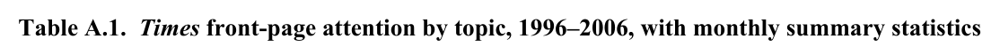

| Topic | Stories | Share of all stories |
|---|---:|---:|
| International affairs and foreign aid | 6,354 | 20.5% |
| Defense | 4,479 | 14.4% |
| Health | 1,799 | 5.8% |
| Energy | 299 | 1.0% |

Selected rows; full corpus: **31,034 stories**.

::::::
::: {.source}
Boydstun (2013), [Table A.1](https://www.amber-boydstun.com/uploads/1/0/6/5/106535199/tablea.1.pdf). Selected topic counts from the original study.
:::

## Nielsen: estimating ideological language
:::::: {.slide-body}
::::: {.columns .case-columns}
:::: {.column .nielsen-cover}
{.book-cover fig-alt="Deadly Clerics: Blocked Ambition and the Paths to Jihad, Richard A. Nielsen. Instructor-supplied book cover."}

::: {.caption}
Cambridge University Press, 2017
:::
::::
:::: {.column}
- **Texts:** Arabic writings by clerics.
- **Measure:** language-based jihad score.
- **Use:** study networks, careers and ideological differences.
::::
:::::
::::::
::: {.source}
§19.3. Nielsen (2017), [Deadly Clerics](https://www.mit.edu/~rnielsen/deadlyclerics.htm).
:::

## Nielsen: from reference texts to a score
:::::: {.slide-body}
::::: {.columns .case-columns .nielsen-measurement-columns}
:::: {.column}
::: {.screenshot-viewport .nielsen-methods-shot}
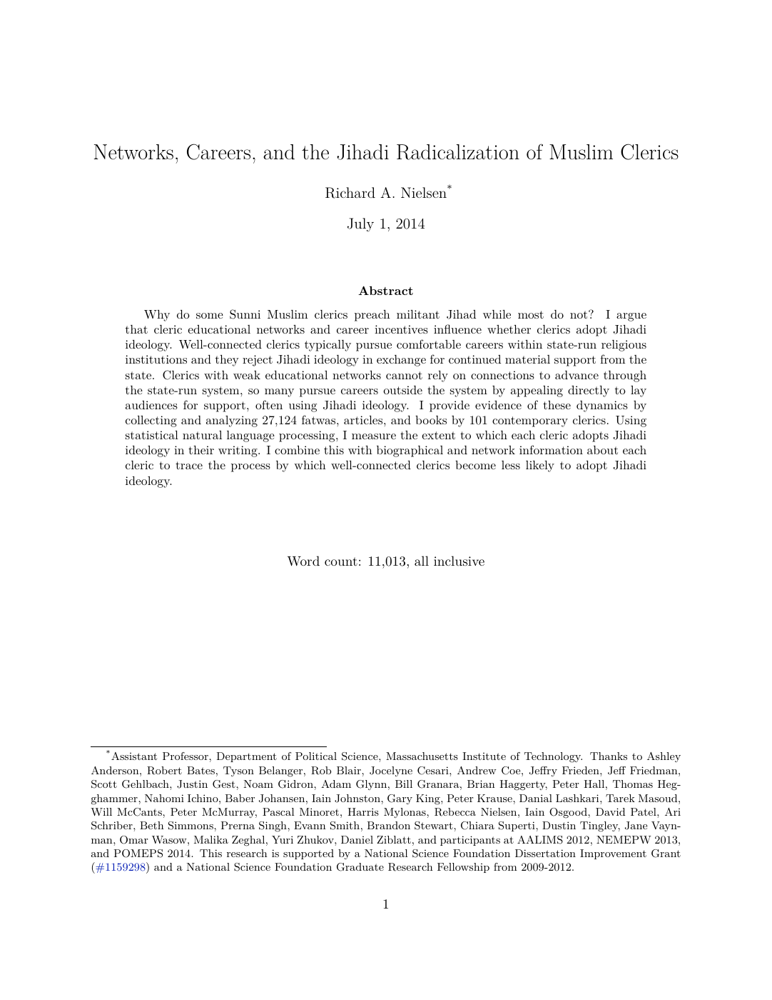{fig-alt="First page of Nielsen’s 2014 working paper, displayed at reduced size."}
:::

::: {.caption}
Working paper · July 2014
:::
::::
:::: {.column}
- **Measure:** how strongly a cleric’s writing expresses militant Jihadi ideology.
- **Supervision:** 765 jihadist-curated texts versus 1,951 sampled cleric texts, a mixed baseline.
- **NB weights:** words more common in jihadist references raise the score; words more common in the baseline lower it.
- **Aggregation:** join each cleric’s writings and add these word weights.
- **Interpretation:** higher scores mean language more like the jihadist references; the measure is continuous.
::::
:::::
::::::
::: {.source}
Method supplement: [Nielsen (2014), §4.1, pp. 13–14](https://www.mit.edu/~rnielsen/jihad.pdf). Earlier working paper, separate from the 2017 book.
:::

## Nielsen: independent checks on the scores
:::::: {.slide-body}
::::: {.columns .paper-intro-columns .nielsen-validation-columns}
:::: {.column}
::: {.screenshot-viewport .nielsen-validation-shot}
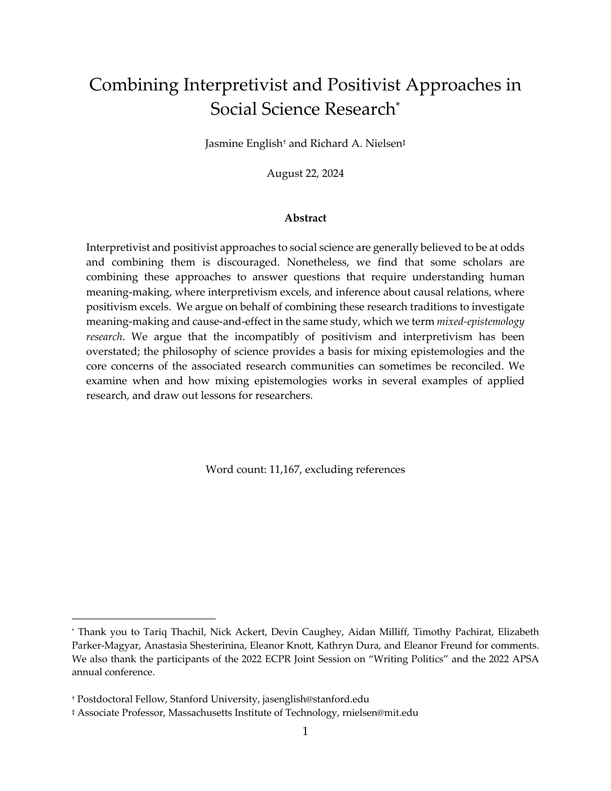{fig-alt="Title and author region of English and Nielsen’s 2024 methodological manuscript, displayed at reduced size."}
:::

::::
:::: {.column}
- **Paper's argument:** combine understanding actors’ meanings with quantitative tests of causes.
- **Nielsen case:** treat clerics as scholars, then test whether blocked careers predict jihadist rhetoric.
- **Language check:** explain why “apostasy” signals jihadist ideology in context.
- **External checks:** compare scores with biographies and scholarly classifications (2014), plus a jihadist infographic criticizing non-jihadist preachers (2017).
- **Our check:** use evidence outside the training texts to see what the score means.
::::
:::::
::::::
::: {.source}
Book connection: §20.3. Nielsen (2017), Ch. 5. [Nielsen (2014), pp. 15–17](https://www.mit.edu/~rnielsen/jihad.pdf); [English & Nielsen (2024), pp. 23–24](https://www.mit.edu/~rnielsen/combining.pdf).
:::

## Nielsen: the limits of external validation
:::::: {.slide-body}
**If a biography omits ideology, we cannot label the person non-jihadist on that basis.**

Some biographies identify jihadist commitments explicitly. Others omit ideology. Silence cannot establish non-jihadist status.

**Course discussion:** could a text criticizing jihadism receive a high score because it discusses the same vocabulary?

Let's read passages in context and compare genres and authors. A separate benchmark checks the scores; close reading helps us understand the language behind them.

For our hate-speech task, let's check comments that quote abuse in order to reject it.
::::::
::: {.source}
Nielsen (2013), [dissertation, §4.4.1, pp. 121–122](https://dash.harvard.edu/handle/1/11124850); Nielsen (2014), p. 17 n. 16. Discussion and hate-speech application are course extensions.
:::

## Park: measuring political grandstanding
:::::: {.slide-body}
::::: {.columns .paper-intro-columns .park-intro-aligned}
:::: {.column}
::: {.screenshot-viewport}
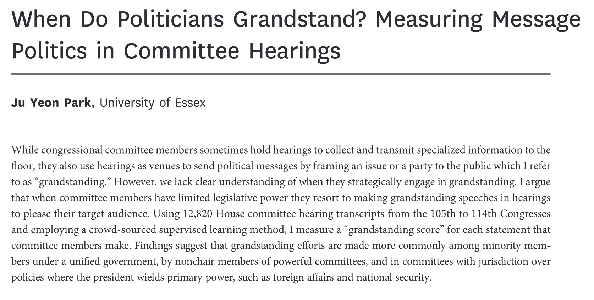{fig-alt="Instructor-supplied article screenshot: When Do Politicians Grandstand? Measuring Message Politics in Committee Hearings, Ju Yeon Park."}
:::

::::
:::: {.column}
- **Texts:** US House hearing statements.
- **Study:** crowd coding and grandstanding scores.
- **Our practice:** Park (2021) data, `rescaled_gs` labels; mlr3 linear SVM.
::::
:::::
::::::
::: {.source}
[Park (2021), JOP 83(1): 214–228](https://doi.org/10.1086/709147) · [Author manuscript](https://repository.essex.ac.uk/27769/1/Manuscript_JOP_final2.pdf).
:::

## Grandstanding: predicting the score
:::::: {.slide-body}
::::: {.columns .paper-figure-columns}
:::: {.column}
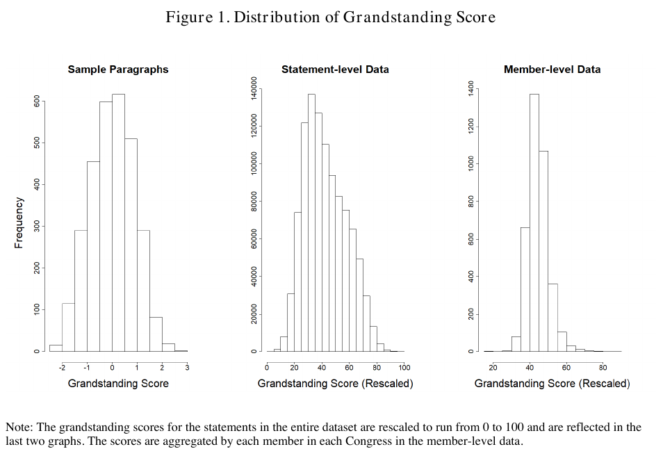{fig-alt="Original manuscript Figure 1: grandstanding distributions for sampled paragraphs, full statements, and member-level aggregates."}

::: {.caption}
Figure 1 · author manuscript
:::
::::
:::: {.column}
- **Labels:** 3,000 crowd-rated paragraphs.
- **Test:** 300 reserved paragraphs.
- **RMSE:** **0.613**, original units.
::::
:::::
::::::
::: {.source}
[Park (2021)](https://doi.org/10.1086/709147), manuscript Figure 1 and pp. 16–18.
:::

## Grandstanding: using the measure in research
:::::: {.slide-body}
::::: {.columns .paper-figure-columns}
:::: {.column}
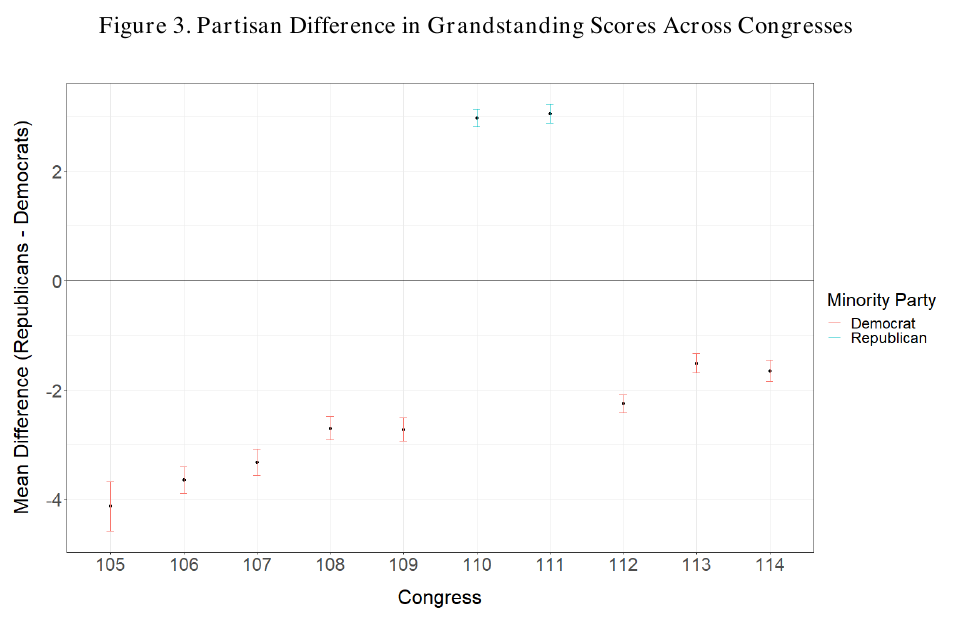{fig-alt="Original manuscript Figure 3: Republican-minus-Democratic grandstanding differences by Congress, with minority-party legend."}

::: {.caption}
Ju Yeon Park (2021)
:::
::::
:::: {.column}
- **Axis:** Republican − Democratic means.
- **Pattern:** minority party scores higher.
- **Interpretation:** messaging and power.
::::
:::::
::::::
::: {.source}
[Park (2021)](https://doi.org/10.1086/709147), manuscript Figure 3, p. 20.
:::

## Coding and measurement choices
:::::: {.slide-body .compact-table}
**Let's use these studies to think through our hate-speech task.**

| Design choice | Question for W6 |
|---|---|
| Coding unit | Does one sentence contain enough evidence for our category? |
| Repeated judgments | Which disagreements should trigger human review? |
| Aggregation | Do we need comment labels, hate-speech shares, or a continuous score? |
| Validation | Which independent evidence tests the intended interpretation? |

Before adding raters or models, let's check that our coding rule fits the question.
::::::
::: {.source}
Course synthesis from the preceding research cases, including [Benoit et al. (2016)](https://doi.org/10.1017/S0003055416000058).
:::

## From labelled data to evaluation {#w6-workflow}
:::::: {.slide-body}
```{=html}
<div class="workflow-tabset" id="w6-workflow-tabs" data-arrow-tabs="true">
<div class="workflow-tablist" role="tablist" aria-label="Supervised classification workflow">
<button type="button" role="tab" id="w6-flow-tab-1" aria-controls="w6-flow-panel-1" aria-selected="true" tabindex="0">1. Get labels</button>
<button type="button" role="tab" id="w6-flow-tab-2" aria-controls="w6-flow-panel-2" aria-selected="false" tabindex="-1">2. Split documents</button>
<button type="button" role="tab" id="w6-flow-tab-3" aria-controls="w6-flow-panel-3" aria-selected="false" tabindex="-1">3. Fit ML Classifier</button>
<button type="button" role="tab" id="w6-flow-tab-4" aria-controls="w6-flow-panel-4" aria-selected="false" tabindex="-1">4. Predict and check</button>
</div>
<div class="workflow-sequence r-stack">
<div class="workflow-panel fragment fade-out" id="w6-flow-panel-1" role="tabpanel" aria-labelledby="w6-flow-tab-1" data-fragment-index="0" data-pdf-title="1. Obtain labelled data">
<div class="workflow-strip">
<div class="workflow-node">Define the concept</div>
<div class="workflow-node is-current">Annotate or find labels</div>
<div class="workflow-node">Audit the labels</div>
<div class="workflow-node">One row per text</div>
</div>
<ul>
<li>Create labels: write a codebook, collect independent judgments and adjudicate disagreements.</li>
<li>Use existing labels: check the source, coding unit, definition and score-to-category conversion.</li>
<li>Our cases: hate-speech labels from Wang, Day & Wu (2022) and the rescaled_gs categories in the Park (2021) data.</li>
</ul>
</div>
<div class="workflow-panel fragment current-visible" id="w6-flow-panel-2" role="tabpanel" aria-labelledby="w6-flow-tab-2" data-fragment-index="0" data-pdf-title="2. Split labelled documents">
<div class="workflow-split">
<div class="workflow-origin">Labelled documents</div>
<div class="workflow-branches two-branches">
<div class="workflow-node"><strong>Training: 80%</strong><br>Learn vocabulary and classifier</div>
<div class="workflow-node"><strong>Test: 20%</strong><br>Predict and check labels</div>
</div>
</div>
<ul>
<li>Split the labelled documents before vocabulary selection or model fitting.</li>
<li>Use a fixed stratified 80/20 split; keep test labels outside fitting.</li>
<li>Apply the same workflow to both hate speech and grandstanding.</li>
</ul>
</div>
<div class="workflow-panel fragment current-visible" id="w6-flow-panel-3" role="tabpanel" aria-labelledby="w6-flow-tab-3" data-fragment-index="1" data-pdf-title="3. Fit ML Classifier">
<div class="workflow-strip">
<div class="workflow-node">Training texts</div>
<div class="workflow-node">Text features</div>
<div class="workflow-node is-current"><span>quanteda.<wbr>textmodels<br>or mlr3</span></div>
<div class="workflow-node">Fitted classifier</div>
</div>
<ul>
<li>Chinese comments: character counts. English excerpts: word counts.</li>
<li>Choose the vocabulary using training texts only.</li>
<li>Fit the classifier using the training feature matrix and matching labels.</li>
<li>Classroom example: textmodel_nb() fits multinomial Naive Bayes.</li>
</ul>
</div>
<div class="workflow-panel fragment current-visible" id="w6-flow-panel-4" role="tabpanel" aria-labelledby="w6-flow-tab-4" data-fragment-index="2" data-pdf-title="4. Predict and check labels">
<div class="workflow-strip">
<div class="workflow-node">Test texts</div>
<div class="workflow-node">Match vocabulary</div>
<div class="workflow-node is-current">predict()</div>
<div class="workflow-node">Compare with labels</div>
</div>
<ul>
<li>Match test features to the training vocabulary, in the same order.</li>
<li>Read predicted categories, the confusion table and F1.</li>
<li>Hate-speech extension: check separate human-reference comments.</li>
</ul>
</div>
</div>
</div>
```
::::::
::: {.source}
Data: [Wang, Day & Wu (2022)](https://doi.org/10.1109/ACCESS.2022.3160712) · [Park (2021)](https://doi.org/10.1086/709147) · [Classroom ZIP](../downloads/week6-classroom.zip).
:::

## R tools for document classification
:::::: {.slide-body .compact-table}
**We'll use R to prepare text features, train classifiers and check predictions.**

| What we need | R tools |
|---|---|
| Convert text to features | `quanteda` |
| Fit a text classifier directly | `quanteda.textmodels` |
| Organize models and evaluation | **`mlr3`** |
| Connect preprocessing steps | `mlr3pipelines` |
| Search model settings | `mlr3tuning` |

**When we need resampling, model comparison, pipelines or tuning, we can use mlr3.**

**For our NB exercise,** we'll fit the model directly with `quanteda.textmodels`.
::::::
::: {.source}
Official documentation: [quanteda](https://quanteda.io/) · [mlr3](https://mlr-org.com/) · [pipelines](https://mlr3pipelines.mlr-org.com/) · [tuning](https://mlr3tuning.mlr-org.com/).
:::

## Introducing mlr3: machine learning in R
:::::: {.slide-body}
::::: {.columns .paper-intro-columns}
:::: {.column}
{fig-alt="Actual screenshot of the official mlr3 homepage, showing the Machine Learning in R heading and framework capabilities."}

::: {.caption}
Official homepage · mlr-org.com · captured 2026-10-15
:::
::::
:::: {.column}
- **Framework:** one interface for different learners.
- **Task + learner:** define the target and fit a model.
- **Evaluation:** resampling, measures and extensions.
::::
:::::
::::::
::: {.source}
[mlr3 official website](https://mlr-org.com/) · [Applied Machine Learning Using mlr3 in R](https://mlr3book.mlr-org.com/chapters/chapter2/data_and_basic_modeling.html).
:::

## mlr3 and the Python ML ecosystem
:::::: {.slide-body .compact-table}
| Need | R: mlr3 ecosystem | Python: scikit-learn ecosystem |
|---|---|---|
| Model interface | Task + learner | Estimator |
| Fit / predict | `$train()` / `$predict()` | `.fit()` / `.predict()` |
| Text features | `quanteda` counts / TF-IDF | `CountVectorizer` / `TfidfVectorizer` |
| Preprocessing + model | `mlr3pipelines` | `Pipeline` |
| Cross-validation | `resample()` | `cross_validate()` |
| Parameter search | `mlr3tuning` | `GridSearchCV` |

**Same workflow:** define the target, separate training and test data, then evaluate predictions.
::::::
::: {.source}
[mlr3 book](https://mlr3book.mlr-org.com/) · [mlr3pipelines](https://mlr3pipelines.mlr-org.com/) · [mlr3tuning](https://mlr3tuning.mlr-org.com/) · [scikit-learn guide](https://scikit-learn.org/stable/getting_started.html) · [text features](https://scikit-learn.org/stable/modules/feature_extraction.html#text-feature-extraction).
:::

## Simple models with quanteda.textmodels
:::::: {.slide-body .compact-table}
We can train a simple text classifier directly from a **DFM and training labels**.

| Model | Function |
|---|---|
| Naive Bayes | `textmodel_nb()` |
| Regularized logistic regression | `textmodel_lr()` |
| Linear SVM | `textmodel_svmlin()` |

**Linear SVM:** experimental, for two classes.

**We'll fit NB** with training counts and labels, then predict held-out texts.
::::::
::: {.source}
[quanteda.textmodels manual](https://cran.r-project.org/web/packages/quanteda.textmodels/quanteda.textmodels.pdf) · [Package source and documentation](https://github.com/quanteda/quanteda.textmodels).
:::

## ML Exercise (NB and SVM)
:::::: {.slide-body .compact-table}
| Case | Classifier | Model interface |
|---|---|---|
| **Taiwan political hate speech** | Multinomial Naive Bayes | `quanteda.textmodels` |
| **Political grandstanding** | Linear SVM | `mlr3` + `mlr3learners` |

We will use the data from **Wang, Day & Wu (2022)** and **Park (2021)**.

**We'll use the same steps:** load → split → features → fit classifier → predict → check labels.
::::::
::: {.source}
[Wang, Day & Wu (2022)](https://doi.org/10.1109/ACCESS.2022.3160712); [Park (2021)](https://doi.org/10.1086/709147) · [Classroom ZIP](../downloads/week6-classroom.zip).
:::

## Our datasets: Grandstanding and Hate Speech
:::::: {.slide-body}
::::: {.columns .coding-steps .dataset-columns}
:::: {.column}
### Grandstanding Measurement (2021)

- **Unit:** English hearing excerpt.
- **Rows:** 3,500 source / 3,499 distinct.
- **Text → target:** `speech` → `rescaled_gs` (0/1).
- **Score field:** `sentimentit_score` (unused).

**First 3 rows** · `gscore_julia_park.csv`

| Row | `speech` (preview) | `rescaled_gs` |
|---|---|---:|
| 1 | Beautiful, because that brings me to my ne… | 0 |
| 2 | And so, while there may have been an indic… | 1 |
| 3 | Yeah, and I do not think there has been in… | 0 |
::::
:::: {.column}
### Taiwan Political Hate Speech (2022)

- **Unit:** Chinese news comment.
- **Rows:** 31,071 source / 4,000 practice.
- **Text → target:** `text` → `hate_speech` (0/1).
- **Other field:** `label`, the category name.

**First 3 rows** · `merged-hate-speeches.csv`

| Row | `text` | `hate_speech` |
|---|---|---:|
| 1 | 係阿6啊~ | 0 |
| 2 | 我媽媽說，學生最好騙， 叫我不要上他的當 | 0 |
| 3 | 智X總統 畜X官員 無誤 ？！ | 1 |
::::
:::::

Text previews follow the original CSV row order.
::::::
::: {.source}
[Park (2021)](https://doi.org/10.1086/709147); [Wang, Day & Wu (2022)](https://doi.org/10.1109/ACCESS.2022.3160712).
:::

## R package check {#r-package-check}
:::::: {.slide-body}
```r
# Install once
install.packages(c("quanteda", "quanteda.textmodels",
  "mlr3", "mlr3learners", "e1071", "stringi"),
  repos = "https://cloud.r-project.org")

# Load and check before the exercise
library(quanteda); library(quanteda.textmodels)
library(mlr3); library(mlr3learners)
library(e1071); library(stringi)
lrn("classif.svm")$id
```

**Ready:** all six packages load without errors; the last line returns `"classif.svm"`.
::::::
::: {.source}
[R: install.packages](https://stat.ethz.ch/R-manual/R-release/library/utils/html/install.packages.html) · [mlr3 SVM learner](https://mlr3learners.mlr-org.com/reference/mlr_learners_classif.svm.html).
:::

## The training data: what changes between cases?
:::::: {.slide-body .compact-table}
| Input | Hate speech | Grandstanding |
|---|---|---|
| One row | Chinese comment | English hearing excerpt |
| Label column | `hate_speech` | `rescaled_gs` |
| Positive category | HateSpeech | Grandstanding |
| Features | Chinese character counts | English word counts |
| Classifier | Multinomial NB | Linear SVM |
| Model interface | `quanteda.textmodels` | `mlr3` + `mlr3learners` |

**We'll build features from the text.** The label is what we're trying to predict.
::::::
::: {.source}
Data: [Wang, Day & Wu (2022)](https://doi.org/10.1109/ACCESS.2022.3160712). W6 classroom NB run. Data: [Park (2021)](https://doi.org/10.1086/709147). W6 classroom linear SVM run.
:::

## Labels come before the algorithm
:::::: {.slide-body }
- First, let's read the coding definition and check what one row represents.
- We'll keep the provided labels; we won't invent a new cutoff.
- When we inspect errors, let's read disagreements and uncertain texts closely.

**Hate speech:** use the labels in the Wang, Day & Wu (2022) data.

**Grandstanding:** use `rescaled_gs`; the CSV does not document its original binary cutoff.
::::::
::: {.source}
Data: [Wang, Day & Wu (2022)](https://doi.org/10.1109/ACCESS.2022.3160712). W6 classroom NB run. Data: [Park (2021)](https://doi.org/10.1086/709147). W6 classroom linear SVM run.
:::

## Naive Bayes: enough to start using it
:::::: {.slide-body }
**We'll predict a category from text counts.**

- Fit with a **document–feature matrix** and one label per row.
- NB combines the counted features as evidence for each category.
- `predict()` returns categories; `type = "probability"` returns model probabilities.

Let's focus on **fit → predict → inspect**.
::::::
::: {.source}
[quanteda.textmodels: textmodel_nb](https://quanteda.io/quanteda.textmodels/reference/textmodel_nb.html) · [Classroom ZIP](../downloads/week6-classroom.zip).
:::

## Set up once for both cases
:::::: {.slide-body .setup-code}
Copy and run — **C01**.

```r
# C01: Setup
# install.packages(c("quanteda", "quanteda.textmodels",
#                    "mlr3", "mlr3learners", "e1071", "stringi"))
library(quanteda); library(quanteda.textmodels)
library(mlr3)
quanteda_options(threads = 1)
data_dirs <- c("Data", "W6/lab/Data",
               "W6/classroom/Data", "../Data")
data_dir <- data_dirs[dir.exists(data_dirs)][1]
file.exists(file.path(data_dir, "hate_speech_practice.csv"))
measures <- msrs(c("classif.acc", "classif.precision",
                   "classif.recall", "classif.fbeta"))
```

::::::
::: {.source}
[quanteda.textmodels: textmodel_nb](https://quanteda.io/quanteda.textmodels/reference/textmodel_nb.html) · [Classroom ZIP](../downloads/week6-classroom.zip).
:::

## C01 output: setup check {#output-c01}
:::::: {.slide-body .compact-table}
::: {.console-output-label}
R console output
:::

```{.text code-line-numbers=false}
> file.exists(file.path(data_dir, "hate_speech_practice.csv"))
[1] TRUE
```

| Function | Purpose |
|---|---|
| `quanteda_options()` | Set the text-processing options for this session |
| `msrs()` | Create the accuracy, precision, recall and F1 measure objects |

**Discuss:** What would FALSE tell us about the data path?
::::::
::: {.source}
[quanteda.textmodels: textmodel_nb](https://quanteda.io/quanteda.textmodels/reference/textmodel_nb.html) · [Classroom ZIP](../downloads/week6-classroom.zip).
:::

## Hate speech: load the data
:::::: {.slide-body }
**Copy and run — C02.**

```r
# C02: Load the Wang, Day & Wu (2022) data
hate <- read.csv(file.path(data_dir,
  "hate_speech_practice.csv"), stringsAsFactors = FALSE)
hate$label <- factor(hate$label,
  levels = c("NonHateSpeech", "HateSpeech"))
table(hate$label)
nrow(hate)
```

We'll use `read.csv()` to load 4,000 cleaned comments with their existing labels.
::::::
::: {.source}
Data: [Wang, Day & Wu (2022)](https://doi.org/10.1109/ACCESS.2022.3160712). W6 classroom NB run.
:::

## C02 output: class labels {#output-c02}
:::::: {.slide-body .compact-table}
::: {.console-output-label}
R console output
:::

```{.text code-line-numbers=false}
> table(hate$label)
NonHateSpeech    HateSpeech
         1622          2378
> nrow(hate)
[1] 4000
```

**Discuss:** Which class is more common? What would always predicting that class achieve?
::::::
::: {.source}
Data: [Wang, Day & Wu (2022)](https://doi.org/10.1109/ACCESS.2022.3160712). W6 classroom NB run.
:::

## Hate speech: split documents
:::::: {.slide-body }
**Copy and run — C03.**

```r
# C03: Reserve test comments with mlr3
hs_task <- as_task_classif(hate["label"],
  target = "label", positive = "HateSpeech")
hs_task$col_roles$stratum <- "label"
set.seed(7192)
hs_split <- partition(hs_task, ratio = .8)
parts <- list(train = hate[hs_split$train, ],
              test = hate[hs_split$test, ])
table(parts$train$label)
table(parts$test$label)
```

**With mlr3,** we declare the outcome using `as_task_classif()`, then get row IDs for our split with `partition()`.

::::::
::: {.source}
Data: [Wang, Day & Wu (2022)](https://doi.org/10.1109/ACCESS.2022.3160712). W6 classroom NB run.
:::

## C03 output: training and test counts {#output-c03}
:::::: {.slide-body .compact-table}
::: {.console-output-label}
R console output
:::

```{.text code-line-numbers=false}
> table(parts$train$label)
NonHateSpeech    HateSpeech
         1298          1902
> table(parts$test$label)
NonHateSpeech    HateSpeech
          324           476
```

**Discuss:** Why do we reserve test rows before selecting the vocabulary?
::::::
::: {.source}
Data: [Wang, Day & Wu (2022)](https://doi.org/10.1109/ACCESS.2022.3160712). W6 classroom NB run.
:::

## Hate speech: tokenize Chinese characters
:::::: {.slide-body .function-step}
**Copy and run — C04a_1.**

```r
# C04a_1: Normalize and tokenize Chinese comments
hs_text <- stringi::stri_trans_nfkc(hate$text)
names(hs_text) <- hate$doc_id
hs_tokens <- tokens(hs_text, what = "character",
  remove_punct = TRUE, remove_symbols = TRUE,
  remove_numbers = TRUE)
class(hs_tokens)
```

| Function / object | What it does here |
|---|---|
| `stri_trans_nfkc()` | stringi: normalize Unicode forms in a working text copy. |
| `quanteda::tokens()` | Turn each comment into character tokens. |
::::::
::: {.source}
Data: [Wang, Day & Wu (2022)](https://doi.org/10.1109/ACCESS.2022.3160712). W6 classroom NB run. · [quanteda tokens](https://quanteda.io/reference/tokens.html)
:::

## C04a_1 output: the tokens object {#output-c04a_1}
:::::: {.slide-body .compact-table}
::: {.console-output-label}
R console output
:::

```{.text code-line-numbers=false}
> class(hs_tokens)
[1] "tokens"
```

**Discuss:** Why use character tokens here, and what might we lose?
::::::
::: {.source}
Data: [Wang, Day & Wu (2022)](https://doi.org/10.1109/ACCESS.2022.3160712). W6 classroom NB run. · [quanteda tokens](https://quanteda.io/reference/tokens.html)
:::

## Hate speech: turn tokens into a DFM
:::::: {.slide-body .function-step}
**Copy and run — C04a_2.**

```r
# C04a_2: Select Han characters and count features
hs_tokens <- tokens_select(hs_tokens,
  pattern = "^\\p{Han}$", valuetype = "regex")
hs_dfm <- dfm(hs_tokens)
dim(hs_dfm)
```

| Function / object | What it does here |
|---|---|
| `tokens_select()` | Retain tokens matching the Han-character pattern. |
| `dfm()` | Count features in a sparse document-feature matrix. |
::::::
::: {.source}
Data: [Wang, Day & Wu (2022)](https://doi.org/10.1109/ACCESS.2022.3160712). W6 classroom NB run. · [tokens_select](https://quanteda.io/reference/tokens_select.html) · [dfm](https://quanteda.io/reference/dfm.html)
:::

## C04a_2 output: character counts {#output-c04a_2}
:::::: {.slide-body .compact-table}
::: {.console-output-label}
R console output
:::

```{.text code-line-numbers=false}
> dim(hs_dfm)
[1] 4000 2916
```

**Discuss:** What do the 4,000 rows and 2,916 columns represent?
::::::
::: {.source}
Data: [Wang, Day & Wu (2022)](https://doi.org/10.1109/ACCESS.2022.3160712). W6 classroom NB run. · [tokens_select](https://quanteda.io/reference/tokens_select.html) · [dfm](https://quanteda.io/reference/dfm.html)
:::

## Hate speech: select the training vocabulary
:::::: {.slide-body .function-step}
**Copy and run — C04b_1.**

```r
# C04b_1: Trim training features
train_dfm <- dfm_trim(hs_dfm[hs_split$train, ],
  min_docfreq = .01, docfreq_type = "prop")
train_label <- parts$train$label
dim(train_dfm)
```

| Function / object | What it does here |
|---|---|
| `dfm_trim()` | Keep features occurring in at least 1% of training documents. |
| `train_label` | Keep one label per training row, in the same order. |
::::::
::: {.source}
Data: [Wang, Day & Wu (2022)](https://doi.org/10.1109/ACCESS.2022.3160712). W6 classroom NB run. · [dfm_trim](https://quanteda.io/reference/dfm_trim.html)
:::

## C04b_1 output: the training vocabulary {#output-c04b_1}
:::::: {.slide-body .compact-table}
::: {.console-output-label}
R console output
:::

```{.text code-line-numbers=false}
> dim(train_dfm)
[1] 3200  603
```

**Discuss:** Does min_docfreq count documents or total token occurrences?
::::::
::: {.source}
Data: [Wang, Day & Wu (2022)](https://doi.org/10.1109/ACCESS.2022.3160712). W6 classroom NB run. · [dfm_trim](https://quanteda.io/reference/dfm_trim.html)
:::

## Hate speech: match the test columns
:::::: {.slide-body .function-step}
**Copy and run — C04b_2.**

```r
# C04b_2: Match test features to training columns
test_dfm <- dfm_match(hs_dfm[hs_split$test, ],
  features = featnames(train_dfm))
dim(test_dfm)
identical(featnames(train_dfm), featnames(test_dfm))
```

| Function / object | What it does here |
|---|---|
| `featnames()` | Read the training feature names in column order. |
| `dfm_match()` | Match that order, drop extra features and fill missing ones with zero. |
::::::
::: {.source}
Data: [Wang, Day & Wu (2022)](https://doi.org/10.1109/ACCESS.2022.3160712). W6 classroom NB run. · [dfm_match](https://quanteda.io/reference/dfm_match.html)
:::

## C04b_2 output: matching test features {#output-c04b_2}
:::::: {.slide-body .compact-table}
::: {.console-output-label}
R console output
:::

```{.text code-line-numbers=false}
> dim(test_dfm)
[1] 800 603
> identical(featnames(train_dfm), featnames(test_dfm))
[1] TRUE
```

**Discuss:** Why must the 800 test rows use the same 603 columns in the same order?
::::::
::: {.source}
Data: [Wang, Day & Wu (2022)](https://doi.org/10.1109/ACCESS.2022.3160712). W6 classroom NB run. · [dfm_match](https://quanteda.io/reference/dfm_match.html)
:::

## Hate speech: fit NB
:::::: {.slide-body }
**Copy and run — C05.**

```r
# C05: Fit Naive Bayes
nb <- textmodel_nb(train_dfm, y = train_label,
  distribution = "multinomial", smooth = 1,
  prior = "docfreq")
class(nb)
nb$distribution
```

We'll give `textmodel_nb()` the counts and matching labels. It returns our fitted NB model.

::::::
::: {.source}
[quanteda.textmodels: textmodel_nb](https://quanteda.io/quanteda.textmodels/reference/textmodel_nb.html) · [Classroom ZIP](../downloads/week6-classroom.zip).
:::

## C05 output: the fitted NB model {#output-c05}
:::::: {.slide-body .compact-table}
::: {.console-output-label}
R console output
:::

```{.text code-line-numbers=false}
> class(nb)
[1] "textmodel_nb" "textmodel"    "list"
> nb$distribution
[1] "multinomial"
```

| Argument | What we supply |
|---|---|
| `x` | Training feature counts |
| `y` | Labels in the same row order |
| `smooth = 1` | Smoothing for counts |
| `prior = "docfreq"` | Training label frequencies |

**Discuss:** Which argument supplies the training labels?
::::::
::: {.source}
[quanteda.textmodels: textmodel_nb](https://quanteda.io/quanteda.textmodels/reference/textmodel_nb.html) · [Classroom ZIP](../downloads/week6-classroom.zip).
:::

## Hate speech: predict and check
:::::: {.slide-body }
**Copy and run — C06.**

```r
# C06: Predict and evaluate with mlr3
nb_prediction <- predict(nb, newdata = test_dfm)
nb_check <- PredictionClassif$new(task = hs_task,
  row_ids = hs_split$test,
  truth = hs_task$truth(hs_split$test),
  response = as.character(nb_prediction))
nb_check$confusion
nb_scores <- nb_check$score(measures)
round(nb_scores, 3)
```

We'll predict with the quanteda NB model, pair those predictions with test labels using `PredictionClassif$new()`, then calculate metrics with `$score()`.

::::::
::: {.source}
Data: [Wang, Day & Wu (2022)](https://doi.org/10.1109/ACCESS.2022.3160712). W6 classroom NB run.
:::

## C06 output: predictions and errors {#output-c06}
:::::: {.slide-body .compact-table}
::: {.console-output-label}
R console output
:::

```{.text code-line-numbers=false}
> nb_check$confusion
               truth
response        HateSpeech NonHateSpeech
  HateSpeech           371           140
  NonHateSpeech        105           184
> round(nb_scores, 3)
      classif.acc classif.precision    classif.recall     classif.fbeta
            0.694             0.726             0.779             0.752
```

**Discuss (2 minutes):** Rows are predictions. Which cells are false positives and false negatives?
::::::
::: {.source}
Data: [Wang, Day & Wu (2022)](https://doi.org/10.1109/ACCESS.2022.3160712). W6 classroom NB run.
:::

## Hate speech: predict one actual comment
:::::: {.slide-body }
**Copy and run — C07.**

```r
# C07: Inspect one held-out comment
i <- match("hs_26234", parts$test$doc_id)
cat(parts$test$text[i], "\n")
predict(nb, newdata = test_dfm[i, ])
round(predict(nb, newdata = test_dfm[i, ],
              type = "probability"), 3)
parts$test$label[i]
```

We'll represent the full comment using the **same training vocabulary**.
::::::
::: {.source}
Data: [Wang, Day & Wu (2022)](https://doi.org/10.1109/ACCESS.2022.3160712). W6 classroom NB run.
:::

## C07 output: one hate-speech prediction {#output-c07}
:::::: {.slide-body .compact-table}
> 垃圾426，滾回去中國，永不得進來台灣（You mainland Chinese scum, get back to China and never set foot in Taiwan.）

**Comment ID:** `hs_26234`

| What to read | Result for this comment |
|---|---|
| Model prediction | `HateSpeech` |
| Model probability | `P(HateSpeech) = 0.999` |
| Reference label | `HateSpeech` |

**Discuss:** Which words express group-based degradation or exclusion?
::::::
::: {.source}
Data: [Wang, Day & Wu (2022)](https://doi.org/10.1109/ACCESS.2022.3160712). W6 classroom NB run.
:::

## C07: inspect the R output {#c07-console-output}
:::::: {.slide-body .compact-table}
::: {.console-output-label}
R console output
:::

```{.text code-line-numbers=false}
> predict(nb, newdata = test_dfm[i, ])
  hs_26234
HateSpeech
Levels: NonHateSpeech HateSpeech
> round(predict(nb, newdata = test_dfm[i, ], type = "probability"), 3)
docs       NonHateSpeech HateSpeech
  hs_26234         0.001      0.999
> parts$test$label[i]
[1] HateSpeech
Levels: NonHateSpeech HateSpeech
```

- `Levels` lists the two possible categories.
- `0.999` is a model probability, not overall accuracy.
::::::
::: {.source}
Data: [Wang, Day & Wu (2022)](https://doi.org/10.1109/ACCESS.2022.3160712). W6 classroom NB run.
:::

## A separate human-reference check
:::::: {.slide-body }
- **Merged file:** `hate_speech_reference.csv` combines two 1,000-comment validation files.
- **BERT / Lexicon:** names of the original files, recorded in the **`source`** column.
- **Reference label:** **`label`** comes from **是否仇恨 (Hate speech: Yes/No)**, not the original model-prediction columns.
- **1,968 distinct comments** remain after duplicate/conflict checks and are excluded from training.

We'll check these comments **after fitting** and keep the model fixed.
::::::
::: {.source}
Data: [Wang, Day & Wu (2022)](https://doi.org/10.1109/ACCESS.2022.3160712). W6 classroom NB run.
:::

## Hate speech: human-reference features
:::::: {.slide-body }
**Copy and run — C08a.**

```r
# C08a: Match human-reference texts to the vocabulary
benchmark <- read.csv(file.path(data_dir,
  "hate_speech_reference.csv"), stringsAsFactors = FALSE)
benchmark$label <- factor(benchmark$label,
  levels = c("NonHateSpeech", "HateSpeech"))
ref_text <- stringi::stri_trans_nfkc(benchmark$text)
names(ref_text) <- benchmark$doc_id
ref_tokens <- tokens(ref_text, what = "character",
  remove_punct = TRUE, remove_symbols = TRUE,
  remove_numbers = TRUE)
ref_dfm <- dfm_match(dfm(ref_tokens),
  features = featnames(train_dfm))
dim(ref_dfm); sum(ntoken(ref_dfm) == 0)
```

::::::
::: {.source}
Data: [Wang, Day & Wu (2022)](https://doi.org/10.1109/ACCESS.2022.3160712). W6 classroom NB run.
:::

## C08a output: reference features {#output-c08a}
:::::: {.slide-body .compact-table}
::: {.console-output-label}
R console output
:::

```{.text code-line-numbers=false}
> dim(ref_dfm)
[1] 1968  603
> sum(ntoken(ref_dfm) == 0)
[1] 17
```

**Discuss:** Do the 17 zero-feature rows mean empty comments or no retained characters?
::::::
::: {.source}
Data: [Wang, Day & Wu (2022)](https://doi.org/10.1109/ACCESS.2022.3160712). W6 classroom NB run.
:::

## Hate speech: check human references
:::::: {.slide-body}
**Copy and run — C08b.**

```r
# C08b: Evaluate the separate human references
ref_task <- as_task_classif(benchmark["label"],
  target = "label", positive = "HateSpeech")
benchmark$prediction <- predict(nb, newdata = ref_dfm)
ref_check <- PredictionClassif$new(task = ref_task,
  row_ids = ref_task$row_ids,
  response = as.character(benchmark$prediction))
benchmark_scores <- ref_check$score(measures)
nrow(benchmark); round(benchmark_scores, 3)
```

We'll put the reference labels and predictions together in `PredictionClassif$new()`, then calculate our selected metrics with `$score(measures)`.

::::::
::: {.source}
Data: [Wang, Day & Wu (2022)](https://doi.org/10.1109/ACCESS.2022.3160712). W6 classroom NB run.
:::

## C08b output: human-reference evaluation {#output-c08b}
:::::: {.slide-body .compact-table}
::: {.console-output-label}
R console output
:::

```{.text code-line-numbers=false}
> nrow(benchmark)
[1] 1968
> round(benchmark_scores, 3)
      classif.acc classif.precision    classif.recall     classif.fbeta
            0.514             0.165             0.880             0.278
```

**Discuss (2 minutes):** Recall is .880, but precision is .165. What errors does that imply?
::::::
::: {.source}
Data: [Wang, Day & Wu (2022)](https://doi.org/10.1109/ACCESS.2022.3160712). W6 classroom NB run.
:::

## Hate speech: compare evaluation samples
:::::: {.slide-body .compact-table}
| Check | Internal test | Human references |
|---|---:|---:|
| Comments | 800 | 1,968 |
| HateSpeech precision | .726 | .165 |
| HateSpeech recall | .779 | .880 |
| HateSpeech F1 | .752 | .278 |

**Let's read precision alongside recall.** This simple NB produces many false positives on the separate sample, despite its high recall.
::::::
::: {.source}
Data: [Wang, Day & Wu (2022)](https://doi.org/10.1109/ACCESS.2022.3160712). W6 classroom NB run.
:::

## Grandstanding: source and lab columns
:::::: {.slide-body }
**Source:** `gscore_julia_park.csv`.

**Lab:** `grandstanding_practice.csv`.

- `speech` becomes `text`: English hearing excerpt.
- `rescaled_gs` becomes `label`: existing binary category.
- `sentimentit_score` stays outside the predictors.

We'll count English words with quanteda, then fit a **linear SVM with mlr3**.
::::::
::: {.source}
Data: [Park (2021)](https://doi.org/10.1086/709147). W6 classroom linear SVM run.
:::

## Grandstanding: load the data
:::::: {.slide-body }
**Copy and run — G01a.**

```r
# G01a: Load the Park (2021) data
grandstanding <- read.csv(file.path(data_dir,
  "grandstanding_practice.csv"), stringsAsFactors = FALSE)
grandstanding$label <- factor(grandstanding$label,
  levels = c("NonGrandstanding", "Grandstanding"))
table(grandstanding$label)
```

We'll use the CSV's existing `rescaled_gs` categories. One duplicate was removed before class.
::::::
::: {.source}
Data: [Park (2021)](https://doi.org/10.1086/709147). W6 classroom linear SVM run.
:::

## G01a output: grandstanding labels {#output-g01a}
:::::: {.slide-body .compact-table}
::: {.console-output-label}
R console output
:::

```{.text code-line-numbers=false}
> table(grandstanding$label)
NonGrandstanding    Grandstanding
            1846             1653
```

**Discuss:** Which class is more common in the Park (2021) data?
::::::
::: {.source}
Data: [Park (2021)](https://doi.org/10.1086/709147). W6 classroom linear SVM run.
:::

## Grandstanding: reserve test excerpts
:::::: {.slide-body}
**Copy and run — G01b.**

```r
# G01b: Reserve test excerpts with mlr3
gs_task <- as_task_classif(grandstanding["label"],
  target = "label", positive = "Grandstanding")
gs_task$col_roles$stratum <- "label"
set.seed(7192)
gs_split <- partition(gs_task, ratio = .8)
gs_parts <- list(train = grandstanding[gs_split$train, ],
                 test = grandstanding[gs_split$test, ])
table(gs_parts$train$label)
table(gs_parts$test$label)
```

We'll use the row IDs from `partition()` to split the data. Setting `stratum` to the label gives us an approximate 80/20 split within each category.

::::::
::: {.source}
Data: [Park (2021)](https://doi.org/10.1086/709147). W6 classroom linear SVM run.
:::

## G01b output: training and test counts {#output-g01b}
:::::: {.slide-body .compact-table}
::: {.console-output-label}
R console output
:::

```{.text code-line-numbers=false}
> table(gs_parts$train$label)
NonGrandstanding    Grandstanding
            1477             1322
> table(gs_parts$test$label)
NonGrandstanding    Grandstanding
             369              331
```

**Discuss:** How does stratification preserve both categories in the test set?
::::::
::: {.source}
Data: [Park (2021)](https://doi.org/10.1086/709147). W6 classroom linear SVM run.
:::

## Grandstanding: build a corpus and tokens
:::::: {.slide-body .function-step}
**Copy and run — G02a_1.**

```r
# G02a_1: Build an English corpus and tokens
gs_corpus <- corpus(grandstanding,
  text_field = "text", docid_field = "doc_id")
gs_tokens <- tokens(gs_corpus, remove_punct = TRUE,
  remove_symbols = TRUE, remove_numbers = TRUE,
  remove_url = TRUE)
ndoc(gs_corpus)
```

| Function / object | What it does here |
|---|---|
| `corpus()` | Read text and document IDs from the data table. |
| `tokens()` | Split the selected text into words and remove the requested token types. |
::::::
::: {.source}
Data: [Park (2021)](https://doi.org/10.1086/709147). W6 classroom linear SVM run. · [corpus](https://quanteda.io/reference/corpus.html) · [tokens](https://quanteda.io/reference/tokens.html)
:::

## G02a_1 output: the English corpus {#output-g02a_1}
:::::: {.slide-body .compact-table}
::: {.console-output-label}
R console output
:::

```{.text code-line-numbers=false}
> ndoc(gs_corpus)
[1] 3499
```

**Discuss:** Which column supplies text, and which column supplies document IDs?
::::::
::: {.source}
Data: [Park (2021)](https://doi.org/10.1086/709147). W6 classroom linear SVM run. · [corpus](https://quanteda.io/reference/corpus.html) · [tokens](https://quanteda.io/reference/tokens.html)
:::

## Grandstanding: normalize and count words
:::::: {.slide-body .function-step}
**Copy and run — G02a_2.**

```r
# G02a_2: Normalize English tokens and build a DFM
gs_tokens <- tokens_tolower(gs_tokens)
gs_tokens <- tokens_remove(gs_tokens,
  pattern = stopwords("en"))
gs_dfm <- dfm(gs_tokens)
dim(gs_dfm)
```

| Function / object | What it does here |
|---|---|
| `tokens_tolower()` | Combine upper- and lowercase versions of words. |
| `tokens_remove()` | Remove the English stopword list from the tokens. |
| `dfm()` | Count the remaining words for each document. |
::::::
::: {.source}
Data: [Park (2021)](https://doi.org/10.1086/709147). W6 classroom linear SVM run. · [tokens_tolower](https://quanteda.io/reference/tokens_tolower.html) · [tokens_remove](https://quanteda.io/reference/tokens_select.html) · [dfm](https://quanteda.io/reference/dfm.html)
:::

## G02a_2 output: English word counts {#output-g02a_2}
:::::: {.slide-body .compact-table}
::: {.console-output-label}
R console output
:::

```{.text code-line-numbers=false}
> dim(gs_dfm)
[1]  3499 14123
```

**Discuss:** How do these word features differ from the Chinese character features?
::::::
::: {.source}
Data: [Park (2021)](https://doi.org/10.1086/709147). W6 classroom linear SVM run. · [tokens_tolower](https://quanteda.io/reference/tokens_tolower.html) · [tokens_remove](https://quanteda.io/reference/tokens_select.html) · [dfm](https://quanteda.io/reference/dfm.html)
:::

## Grandstanding: trim and align the vocabulary
:::::: {.slide-body .function-step}
**Copy and run — G02a_3.**

```r
# G02a_3: Select training words and match test columns
gs_train_dfm <- dfm_trim(gs_dfm[gs_split$train, ],
  min_docfreq = .01, docfreq_type = "prop")
gs_test_dfm <- dfm_match(gs_dfm[gs_split$test, ],
  features = featnames(gs_train_dfm))
dim(gs_train_dfm); dim(gs_test_dfm)
```

| Function / object | What it does here |
|---|---|
| `dfm_trim()` | Choose words using training document frequencies. |
| `dfm_match()` | Give test documents the same feature columns. |
::::::
::: {.source}
Data: [Park (2021)](https://doi.org/10.1086/709147). W6 classroom linear SVM run. · [dfm_trim](https://quanteda.io/reference/dfm_trim.html) · [dfm_match](https://quanteda.io/reference/dfm_match.html)
:::

## G02a_3 output: aligned English features {#output-g02a_3}
:::::: {.slide-body .compact-table}
::: {.console-output-label}
R console output
:::

```{.text code-line-numbers=false}
> dim(gs_train_dfm)
[1] 2799  629
> dim(gs_test_dfm)
[1] 700 629
```

**Discuss:** Why do both matrices have 629 columns even though they contain different texts?
::::::
::: {.source}
Data: [Park (2021)](https://doi.org/10.1086/709147). W6 classroom linear SVM run. · [dfm_trim](https://quanteda.io/reference/dfm_trim.html) · [dfm_match](https://quanteda.io/reference/dfm_match.html)
:::

## Grandstanding: convert the DFM for mlr3
:::::: {.slide-body .function-step}
**Copy and run — G02b_1.**

```r
# G02b_1: Convert text counts to feature tables
gs_train_data <- convert(gs_train_dfm, to = "data.frame")
gs_test_data <- convert(gs_test_dfm, to = "data.frame")
gs_train_data$doc_id <- NULL; gs_test_data$doc_id <- NULL
dim(gs_train_data); dim(gs_test_data)
```

| Function / object | What it does here |
|---|---|
| `quanteda::convert()` | Turn the small sparse DFM into a dense data frame. |
| `doc_id <- NULL` | Remove the identifier, leaving 629 numeric feature columns. |
::::::
::: {.source}
Data: [Park (2021)](https://doi.org/10.1086/709147). W6 classroom linear SVM run. · [quanteda convert](https://quanteda.io/reference/convert.html)
:::

## G02b_1 output: feature tables without IDs {#output-g02b_1}
:::::: {.slide-body .compact-table}
::: {.console-output-label}
R console output
:::

```{.text code-line-numbers=false}
> dim(gs_train_data)
[1] 2799  629
> dim(gs_test_data)
[1] 700 629
```

**Discuss:** Why should a document ID stay outside the predictor columns?
::::::
::: {.source}
Data: [Park (2021)](https://doi.org/10.1086/709147). W6 classroom linear SVM run. · [quanteda convert](https://quanteda.io/reference/convert.html)
:::

## Grandstanding: add the target column
:::::: {.slide-body .function-step}
**Copy and run — G02b_2.**

```r
# G02b_2: Name feature columns and add labels
names(gs_train_data) <- make.names(featnames(gs_train_dfm),
  unique = TRUE)
names(gs_test_data) <- names(gs_train_data)
gs_train_data$label <- gs_parts$train$label
gs_test_data$label <- factor(gs_parts$test$label,
  levels = c("Grandstanding", "NonGrandstanding"))
dim(gs_train_data); dim(gs_test_data)
```

| Function / object | What it does here |
|---|---|
| `make.names()` | Create valid, unique feature names. |
| `label` | Add the target after the 629 feature columns. |
::::::
::: {.source}
Data: [Park (2021)](https://doi.org/10.1086/709147). W6 classroom linear SVM run. · [mlr3 PredictionClassif](https://mlr3.mlr-org.com/reference/PredictionClassif.html)
:::

## G02b_2 output: features plus the target {#output-g02b_2}
:::::: {.slide-body .compact-table}
::: {.console-output-label}
R console output
:::

```{.text code-line-numbers=false}
> dim(gs_train_data)
[1] 2799  630
> dim(gs_test_data)
[1] 700 630
```

**630 columns = 629 text features + 1 `label` column.**

- **Predictors:** the 629 word-count features.
- **Target:** `label` (Grandstanding / NonGrandstanding), excluded from predictors.

**Discuss:** Why are there now 630 columns, but only 629 predictors?
::::::
::: {.source}
Data: [Park (2021)](https://doi.org/10.1086/709147). W6 classroom linear SVM run. · [mlr3 PredictionClassif](https://mlr3.mlr-org.com/reference/PredictionClassif.html)
:::

## mlr3: define the classification task
:::::: {.slide-body .function-step}
**Copy and run — G02c_1.**

```r
# G02c_1: Define the grandstanding task
gs_model_task <- as_task_classif(gs_train_data,
  target = "label", positive = "Grandstanding")
gs_model_task$target_names
length(gs_model_task$feature_names)
```

| Function / object | What it does here |
|---|---|
| `as_task_classif()` | Describe the training data, target column and positive class. |
| `TaskClassif` | Stores data and roles. Creating the task does not train a model. |
::::::
::: {.source}
Data: [Park (2021)](https://doi.org/10.1086/709147). W6 classroom linear SVM run. · [as_task_classif](https://mlr3.mlr-org.com/reference/as_task_classif.html)
:::

## G02c_1 output: the classification task {#output-g02c_1}
:::::: {.slide-body .compact-table}
::: {.console-output-label}
R console output
:::

```{.text code-line-numbers=false}
> gs_model_task$target_names
[1] "label"
> length(gs_model_task$feature_names)
[1] 629
```

**Discuss:** Which column is the target, and why is it excluded from feature_names?
::::::
::: {.source}
Data: [Park (2021)](https://doi.org/10.1086/709147). W6 classroom linear SVM run. · [as_task_classif](https://mlr3.mlr-org.com/reference/as_task_classif.html)
:::

## mlr3: choose an SVM learner
:::::: {.slide-body .function-step}
**Copy and run — G02c_2.**

```r
# G02c_2: Configure the linear SVM learner
library(mlr3learners)
gs_learner <- lrn("classif.svm", type = "C-classification",
  kernel = "linear", cost = 1, scale = FALSE,
  predict_type = "prob")
gs_learner$id
gs_learner$predict_type
```

| Function / object | What it does here |
|---|---|
| `lrn()` | Create an unfitted learner and set its options. |
| `predict_type = "prob"` | Request class probabilities as well as predicted categories. |
::::::
::: {.source}
Data: [Park (2021)](https://doi.org/10.1086/709147). W6 classroom linear SVM run. · [mlr3 SVM](https://mlr3learners.mlr-org.com/reference/mlr_learners_classif.svm.html)
:::

## G02c_2 output: the configured learner {#output-g02c_2}
:::::: {.slide-body .compact-table}
::: {.console-output-label}
R console output
:::

```{.text code-line-numbers=false}
> gs_learner$id
[1] "classif.svm"
> gs_learner$predict_type
[1] "prob"
```

**Discuss:** Has lrn() already learned from any training rows?
::::::
::: {.source}
Data: [Park (2021)](https://doi.org/10.1086/709147). W6 classroom linear SVM run. · [mlr3 SVM](https://mlr3learners.mlr-org.com/reference/mlr_learners_classif.svm.html)
:::

## mlr3: train and predict
:::::: {.slide-body .function-step}
**Copy and run — G02c_3.**

```r
# G02c_3: Train the learner and predict held-out texts
set.seed(7193)
gs_learner$train(gs_model_task)
gs_result <- gs_learner$predict_newdata(gs_test_data)
gs_prediction <- gs_result$response
length(gs_prediction)
colnames(gs_result$prob)
```

| Function / object | What it does here |
|---|---|
| `$train(task)` | Fit the learner using the training task. |
| `$predict_newdata()` | Return predictions for the held-out feature table. |
| `$response` / `$prob` | Read category labels / the matrix of class probabilities. |
::::::
::: {.source}
Data: [Park (2021)](https://doi.org/10.1086/709147). W6 classroom linear SVM run. · [mlr3 Learner](https://mlr3.mlr-org.com/reference/Learner.html) · [PredictionClassif](https://mlr3.mlr-org.com/reference/PredictionClassif.html)
:::

## G02c_3 output: held-out predictions {#output-g02c_3}
:::::: {.slide-body .compact-table}
::: {.console-output-label}
R console output
:::

```{.text code-line-numbers=false}
> length(gs_prediction)
[1] 700
> colnames(gs_result$prob)
[1] "Grandstanding"    "NonGrandstanding"
```

**Discuss:** Which object stores the fitted learner, and which stores the 700 test predictions?
::::::
::: {.source}
Data: [Park (2021)](https://doi.org/10.1086/709147). W6 classroom linear SVM run. · [mlr3 Learner](https://mlr3.mlr-org.com/reference/Learner.html) · [PredictionClassif](https://mlr3.mlr-org.com/reference/PredictionClassif.html)
:::

## Grandstanding: evaluate mlr3 predictions
:::::: {.slide-body}
**Copy and run — G02d.**

```r
# G02d: Evaluate the mlr3 predictions
gs_result$confusion
gs_scores <- gs_result$score(measures)
round(gs_scores, 3)
```

We'll read the confusion table with `$confusion` and calculate the evaluation scores with `$score(measures)`.

::::::
::: {.source}
Data: [Park (2021)](https://doi.org/10.1086/709147). W6 classroom linear SVM run.
:::

## G02d output: predictions and errors {#output-g02d}
:::::: {.slide-body .compact-table}
::: {.console-output-label}
R console output
:::

```{.text code-line-numbers=false}
> gs_result$confusion
                  truth
response           Grandstanding NonGrandstanding
  Grandstanding              176               74
  NonGrandstanding           155              295
> round(gs_scores, 3)
      classif.acc classif.precision    classif.recall     classif.fbeta
            0.673             0.704             0.532             0.606
```

**Discuss:** Locate the 74 false positives and 155 false negatives.
::::::
::: {.source}
Data: [Park (2021)](https://doi.org/10.1086/709147). W6 classroom linear SVM run.
:::

## Grandstanding: predict one actual excerpt
:::::: {.slide-body }
**Copy and run — G03.**

```r
# G03: Inspect one grandstanding prediction
j <- match("gs_01045", gs_parts$test$doc_id)
cat(gs_parts$test$text[j], "\n")
gs_result$response[j]
round(gs_result$prob[j, ], 3)
gs_result$truth[j]
```

We'll read an excerpt that we kept out of training.
::::::
::: {.source}
Data: [Park (2021)](https://doi.org/10.1086/709147). W6 classroom linear SVM run.
:::

## G03 output: one grandstanding prediction {#output-g03}
:::::: {.slide-body .compact-table}
::: {.console-output-label}
R console output
:::

```{.text code-line-numbers=false}
> gs_result$response[j]
[1] Grandstanding
Levels: Grandstanding NonGrandstanding
> round(gs_result$prob[j, ], 3)
   Grandstanding NonGrandstanding
           0.637            0.363
> gs_result$truth[j]
[1] Grandstanding
Levels: Grandstanding NonGrandstanding
```

**Discuss:** Which words suggest self-promotion? Read the full statement next.
::::::
::: {.source}
Data: [Park (2021)](https://doi.org/10.1086/709147). W6 classroom linear SVM run.
:::

## Grandstanding: read the high-score statement
:::::: {.slide-body }
> Also I have not signed the no tax pledge. [***I am not intimidated by anybody. I am going to do whatever I have to do.***]{.grandstanding-emphasis} I do not like to raise taxes. I do not want to raise taxes. I want to see how we can cut first. But, I also want to deal with the entitlements. The Simpson Bowles Commission is sort of a grand compromise. A grand compromise that not everyone really feels totally comfortable with. But you know that they are kind of moving in the right direction. So we really are going to have to get it out of this administration to participate with us.

**Prediction / reference:** Grandstanding · **SVM probability:** .637

**Let's look for** self-promotion and a stance on taxes. Original score: **2.003**.
::::::
::: {.source}
Data: [Park (2021)](https://doi.org/10.1086/709147). W6 classroom linear SVM run.
:::

## Read performance with the text
:::::: {.slide-body}
Let's run this after G03 in the same R session.

```r
# Read one grandstanding prediction error
error_rows <- which(gs_result$response != gs_result$truth)
k <- error_rows[1]
data.frame(
  doc_id = gs_parts$test$doc_id[k],
  reference = gs_result$truth[k],
  prediction = gs_result$response[k],
  prob = round(gs_result$prob[k, "Grandstanding"], 3),
  row.names = NULL)
cat(gs_parts$test$text[k], "\n")
```

We'll find mismatches with `which()`, select one with `k`, and print its full text with `cat()`.
::::::
::: {.source}
Data: [Park (2021)](https://doi.org/10.1086/709147). W6 classroom linear SVM run.
:::

## Read performance: one false positive {#error-reading-output}
:::::: {.slide-body .error-reading-output}
::: {.console-output-label}
R console output
:::

```{.text code-line-numbers=false}
    doc_id        reference    prediction  prob
1 gs_00013 NonGrandstanding Grandstanding 0.609
```

> I know that Ms. Pingree mentioned the Coastal Climate Resilience Fund. So the district I represent includes a whole bunch of rural communities that lie in the tsunami zone. Coastal communities like Westport and Ocean Shores are seeing much more severe storm events and flooding and there are four coastal tribes in the district that I represent that are in the process of trying to move to higher ground. I was hoping you could provide a roadmap for what this program is going to look like if it is funded, and how the program is going to address the specific needs of the communities I represent and others along the coast.

**Discuss:** Does describing district needs count as self-promotion? What context is missing?
::::::
::: {.source}
Data: [Park (2021)](https://doi.org/10.1086/709147). W6 classroom linear SVM run.
:::

## Optional: reuse the features with other classifiers
:::::: {.slide-body .compact-table}
Let's keep the same training split and vocabulary as we try another classifier.

| Model | Package interface | Prediction |
|---|---|---|
| Logistic regression | `quanteda.textmodels`<br>`textmodel_lr()` | `predict()` |
| Linear SVM | mlr3 `lrn("classif.svm", kernel = "linear")` | `$train()` then `$predict()` |

We can use the package functions directly; the lab shows the complete calls.
::::::
::: {.source}
[quanteda.textmodels](https://quanteda.io/quanteda.textmodels/) · [mlr3 classif.svm](https://mlr3learners.mlr-org.com/reference/mlr_learners_classif.svm.html).
:::

## Later weeks: LLM coding and classification
:::::: {.slide-body}
::::: {.columns .paper-intro-columns}
:::: {.column}
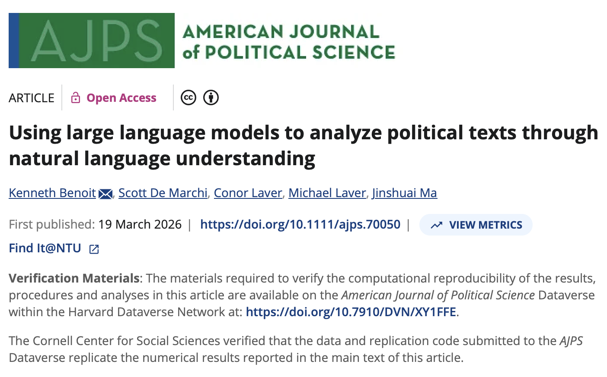{fig-alt="Published AJPS article page: Using large language models to analyze political texts through natural language understanding, Kenneth Benoit and colleagues. Screenshot supplied by instructor."}
::::
:::: {.column}
- **Classification:** prompts and codebooks can guide category labels.
- **AJPS example:** summaries and policy-position scores.
- **Later LLM weeks:** methods and validation.
::::
:::::
::::::
::: {.source}
[Benoit et al. (2026), AJPS](https://doi.org/10.1111/ajps.70050).
:::

## Practice and the Week 7 deadline
:::::: {.slide-body }
**In class, we'll run C01–C08, then G01–G03** (including all substeps), in order in one R session.

- Hate speech: inspect the test and separate human-reference results.
- Grandstanding: fit mlr3 linear SVM using `rescaled_gs`.
- Let's read one error from each case and explain the category boundary.

[Classroom code + data](../downloads/week6-classroom.zip) · [Lab](../lab/Lab_Session_W6.html) · [Worked answers](../lab/answers/Lab_Session_W6_Answers.html)

**Week 7:** proposal due **2026-10-23, before 23:59**. No separate submission for this practice.
::::::
::: {.source}
[quanteda.textmodels: textmodel_nb](https://quanteda.io/quanteda.textmodels/reference/textmodel_nb.html) · [Classroom ZIP](../downloads/week6-classroom.zip).
:::

## Recommended reading priorities
:::::: {.slide-body .compact-table}
| Text as Data chapter | Sections to prioritize | Teaching connection |
|---|---|---|
| **17: An Overview of Supervised Classification** | Overview: 17.2–17.5 | Connect the research steps |
| **18: Coding a Training Set** | **Core: 18.1–18.2** | Codebooks and human labels |
| **19: Classifying Documents with Supervised Learning** | Model detail: 19.1–19.2 | NB and learned classifiers |
| **20: Checking Performance** | **Core: 20.1** | Validation and prediction errors |

**Extensions:** §19.2.3 for aggregate measures; §20.2 for indirect validation.

Chapter 15 provides optional measurement context.
::::::
::: {.source}
Grimmer, Roberts & Stewart (2022), [Text as Data](https://ingramacademic.com/products/text-as-data-9780691207551), Part IV.
:::

## Practice data references
:::::: {.slide-body .reference-list}
Wang, Chih-Chien, Min-Yuh Day, and Chun-Lian Wu. 2022. “Political Hate Speech Detection and Lexicon Building: A Study in Taiwan.” *IEEE Access* 10: 44337–44346. [DOI](https://doi.org/10.1109/ACCESS.2022.3160712).

**Hate-speech data:** Wang, Day & Wu (2022), `merged-hate-speeches.csv`.

**Grandstanding data:** [Park (2021)](https://doi.org/10.1086/709147), `gscore_julia_park.csv`, target `rescaled_gs`.

**Manual benchmark:** the supplied BERT and Lexicon 1,000-comment validation sheets.

W6 results are new classroom runs, separate from the paper’s BERT and lexicon results.
::::::
::: {.source}
Source files and hashes: [data notes](../classroom/Data/README.md).
:::

## Empirical study references
:::::: {.slide-body .reference-list}
- **Gillion, Daniel Q. 2016.** *Governing with Words: The Political Dialogue on Race, Public Policy, and Inequality in America*. Cambridge University Press. [Appendix A](https://doi.org/10.1017/CBO9781316412299.011).
- **Boydstun, Amber E. 2013.** *Making the News: Politics, the Media, and Agenda Setting*. University of Chicago Press. [Codebook, data, and tables](https://www.amber-boydstun.com/supplementary-information-for-making-the-news.html).
- **Nielsen, Richard A. 2017.** *Deadly Clerics: Blocked Ambition and the Paths to Jihad*. Cambridge University Press. [Author's book page](https://www.mit.edu/~rnielsen/deadlyclerics.htm).

**Methods supplements:** [Nielsen (2014)](https://www.mit.edu/~rnielsen/jihad.pdf); [English & Nielsen (2024)](https://www.mit.edu/~rnielsen/combining.pdf).
::::::

## Additional coding study references
:::::: {.slide-body .reference-list}
**Park, Ju Yeon. 2021.** “When Do Politicians Grandstand? Measuring Message Politics in Committee Hearings.” *The Journal of Politics* 83(1): 214–228. [Article](https://doi.org/10.1086/709147) · [Author manuscript](https://repository.essex.ac.uk/27769/1/Manuscript_JOP_final2.pdf).

**Benoit, Kenneth, Drew Conway, Benjamin E. Lauderdale, Michael Laver, and Slava Mikhaylov. 2016.** “Crowd-sourced Text Analysis: Reproducible and Agile Production of Political Data.” *American Political Science Review* 110(2): 278–295. [Article](https://doi.org/10.1017/S0003055416000058) · [Replication](https://github.com/kbenoit/CSTA-APSR).

**Benoit, Kenneth, Scott De Marchi, Conor Laver, Michael Laver, and Jinshuai Ma. 2026.** “Using large language models to analyze political texts through natural language understanding.” *American Journal of Political Science* 70(4): 1589–1605. [Article](https://doi.org/10.1111/ajps.70050) · [Replication](https://doi.org/10.7910/DVN/XY1FFE).

::::::

## References and software
:::::: {.slide-body .reference-list}
**Grimmer, J., M. E. Roberts, and B. M. Stewart (2022).** *Text as Data: A New Framework for Machine Learning and the Social Sciences*. Princeton University Press. Chapters 17–20, with Chapter 15 as background. [Book and contents](https://ingramacademic.com/products/text-as-data-9780691207551).

**Software:** [quanteda](https://quanteda.io/) for text features, `quanteda.textmodels::textmodel_nb()` for Naive Bayes, `quanteda.textmodels::textmodel_lr()` for optional logistic regression, and mlr3 `classif.svm` (with `mlr3learners` and `e1071`) for the grandstanding linear SVM.

**Further tools:** [quanteda.textmodels](https://cran.r-project.org/package=quanteda.textmodels) for text classifiers; [mlr3](https://mlr3.mlr-org.com/) for splitting and evaluation; [Transformers](https://huggingface.co/docs/transformers/tasks/sequence_classification) for the fine-tuning extension.

**R workflow references:** [tidyverse](https://www.tidyverse.org/packages/), [tidymodels](https://www.tidymodels.org/), and the [mlr3 feature-selection chapter](https://mlr3book.mlr-org.com/chapters/chapter6/feature_selection.html).

**Evaluation references:** scikit-learn documentation on [cross-validation](https://scikit-learn.org/stable/modules/cross_validation.html) and [classification metrics](https://scikit-learn.org/stable/modules/model_evaluation.html).

Our hate-speech NB exercise uses Wang, Day & Wu (2022); our grandstanding linear SVM uses Park (2021). We've run predictions for both exercises. Results from the original studies are cited separately.
::::::
